  

### `>_ whoami`

I'm Log. I've found building, creating, and learning to be at the top of my interests. Related to that, IT (cloud and infrastructure) is the field I've found to resonate with me the most!

I started out learning heavily towards security, but over time realized I enjoy working a wide array of technologies and systems at once. That being said, everything I learned in security, I aim to carry into what I create. I believe it reflects in some aspects of my projects.

### `>_ ls ~/interests`

| area | focus |
|---|---|
| **Cloud** | Microsoft Azure, cloud administration, identity, networking |
| **Infrastructure** | Linux, Windows, virtualization, system administration |
| **Automation** | Python, PowerShell, Bash |
| **Security** | Endpoint security, hardening, identity and access management |

### `>_ ls ~/projects`

| repo | what it does |
|---|---|
| [**az-suite**](https://github.com/logjxn/az-suite) | Hands-on Azure administration labs covering identity, networking, compute, and automation. |
| [**isox**](https://github.com/logjxn/ISOx) | Linux `.iso` downloader and verifier supporting 24 distributions, on PyPI, with a full test suite. |
| [**sb-audit**](https://github.com/logjxn/sb-audit) | Windows boot posture auditing. |

### `>_ cat now.txt`

Working toward AZ-104 and building practical experience with cloud and infrastructure.

  

